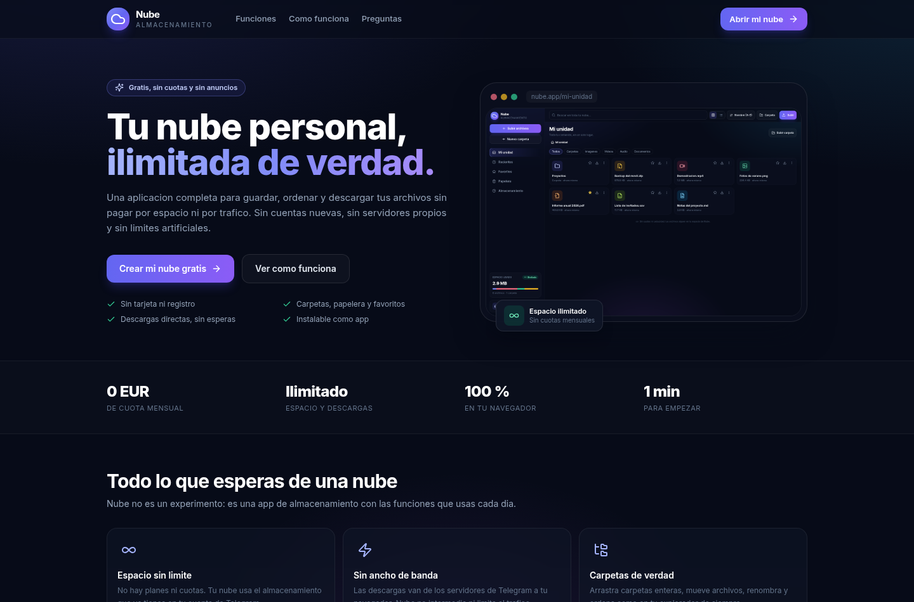
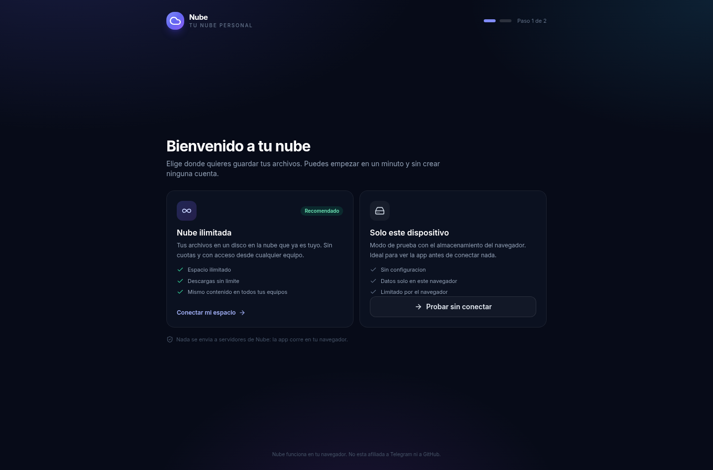
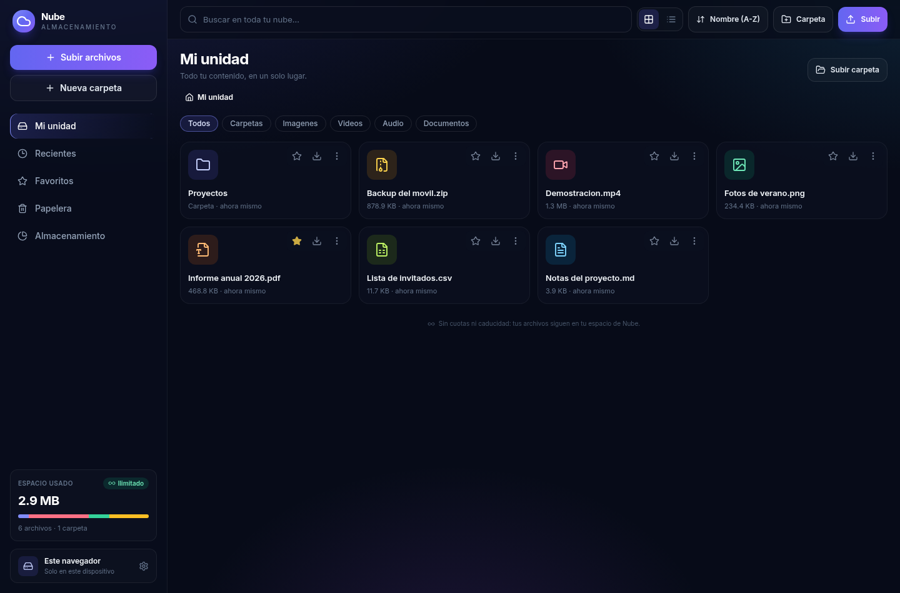
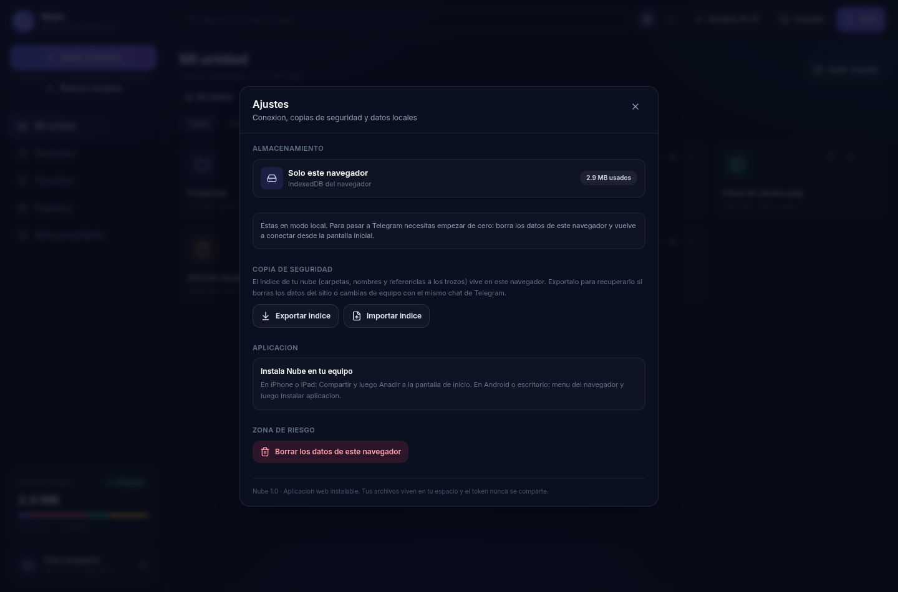
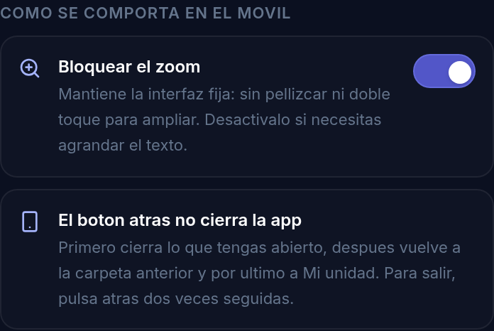

# Nube en GitHub Pages (edicion estatica)

> Publicada en <https://allan506.github.io/app-de-almacenamiento./> con el workflow de este repo.

Guia de la edicion sin backend: una **aplicacion web instalable** de almacenamiento ilimitado que se
publica en GitHub Pages y guarda los archivos en tu propio espacio de Telegram.



## Que es (y que no es)

Nube es una aplicacion con portada, asistente de bienvenida, carpetas, busqueda, favoritos, papelera,
vista previa, descargas y ZIP. Detras usa **tu cuenta de Telegram como disco**, porque es el
almacenamiento gratuito e ilimitado mas fiable que existe. No hay ningun bot con el que hablar: el bot es
solo la llave de ese disco.

| Pieza | Donde vive en esta edicion |
| --- | --- |
| Interfaz (app instalable) | Paquete estatico de `site/` en GitHub Pages (~270 KB) |
| Contenido de los archivos | Chat de tu espacio en Telegram, troceado en partes de 19 MB |
| Indice (carpetas, nombres, favoritos) | IndexedDB de tu navegador, exportable a JSON |
| Acceso | Tu token de espacio (sin cuentas, sin contrasenas) |

La API publica de Telegram responde con `access-control-allow-origin: *`, asi que el navegador sube y
descarga directamente: no hace falta un servidor intermedio ni pagar ancho de banda.

## 1. Crea tu espacio (3 minutos)

1. Abre [@BotFather](https://t.me/BotFather), envia `/newbot` y guarda el **token** (`123456:AA...`).
2. Abre una conversacion con ese bot y pulsa **Iniciar**. Envia cualquier mensaje.
3. En Nube: **Crear mi nube gratis → Nube ilimitada**. Pega el token y pulsa **Detectar**; la app rellena
   el chat automaticamente. Pulsa **Conectar y entrar**.



> Usa un espacio dedicado. Todo lo que subas queda en ese chat: si compartes el token, compartes el acceso.

## 2. Publica la app en GitHub Pages

El repositorio trae el workflow `.github/workflows/pages.yml`, que instala dependencias, ejecuta las
pruebas, compila `site/` y publica el resultado con `actions/deploy-pages`.

1. En GitHub: **Settings → Pages → Build and deployment → Source: GitHub Actions**.
   El workflow tambien intenta crear el sitio la primera vez (`enablement: true`).
2. Haz push a `main` tocando algo en `site/` (o lanza el workflow desde **Actions**).
3. Cuando termina el job `Desplegar`, la URL aparece en el entorno `github-pages` y en
   **Settings → Pages**: `https://<usuario>.github.io/<repositorio>/`.

Cada push que modifique `site/` vuelve a desplegar. El resto del monorepo (backend, docs) no dispara el
workflow.

### Probarlo en local

```bash
cd site
npm ci
npm run dev        # http://localhost:12001
npm test           # troceado, transporte, arbol y zip
npm run build      # genera site/dist
python3 -m http.server 8000 --directory dist   # simula GitHub Pages
```

## 3. Instalala como app

La app incluye `manifest.webmanifest` y un service worker que cachea el armazon, asi que:

- **Android/Chrome**: menu → *Instalar aplicacion* (o el boton **Instalar Nube** de la barra lateral).
- **iPhone/iPad**: Compartir → *Anadir a la pantalla de inicio*.
- **Escritorio**: icono de instalar en la barra de direcciones.

Una vez instalada abre a pantalla completa, con su icono, y el armazon funciona sin conexion. Los
archivos siguen necesitando red, porque viven en tu espacio.



## Como funciona el troceado

La Bot API acepta como maximo 20 MB por subida, asi que cada archivo se parte en trozos de 19 MB que se
envian como documentos independientes:

```
archivo de 45 MB  ->  [19 MB] [19 MB] [7 MB]   ->  3 mensajes en el chat
descarga          ->  getFile + /file/bot... por cada trozo, unidos en un Blob en orden
```

- El indice guarda `file_id` y `message_id` de cada trozo, no los bytes.
- Al borrar definitivamente se llama a `deleteMessage`: el chat tambien se limpia.
- Un archivo puede pesar mas de 2 GB: el limite de Telegram es por mensaje, no por archivo.
- Las carpetas se descargan como `.zip`, generado en el navegador sin servidores intermedios.

## Limites reales (sin marketing)

| Limite | Valor | Por que |
| --- | --- | --- |
| Tamano por trozo | 20 MB (19 MB configurado) | Limite de la Bot API para subidas multipart |
| Tamano por archivo | Sin limite practico | Se compone de varios mensajes |
| Espacio total | El de tu cuenta de Telegram | Un espacio escribe en un chat; no hay cuota de plan |
| Trafico de GitHub | ~270 KB por visita + 100 GB/mes de cortesia | Solo se sirve el armazon de la app |
| Ritmo de subida | Cola de 2 archivos en paralelo | Evita `429 Too Many Requests` |
| Indice | IndexedDB del navegador | Exportalo si cambias de equipo |

Esta edicion no ofrece enlaces publicos: los archivos viven en un chat privado y solo tu token puede
leerlos. Para compartir, reenvia el mensaje desde Telegram o exporta el indice.

## Seguridad

- El token se guarda en IndexedDB de este navegador y solo se envia a `api.telegram.org`.
- Las copias de seguridad (`.json`) incluyen el indice, **no** el token.
- Si el token se filtra, usa `/revoke` en BotFather y crea otro espacio.
- En equipos compartidos usa **Ajustes → Borrar los datos de este navegador**.



## En el movil

La app se comporta como una nativa en el telefono:

- **Zoom bloqueado**: `user-scalable=no`, `touch-action: pan-x pan-y` y cancelacion de los gestos de
  pellizco de Safari. Se puede desactivar en **Ajustes → Como se comporta en el movil** si necesitas
  ampliar el texto; la preferencia se guarda en el navegador (`nube-lite.zoom-lock`).
- **El boton atras no cierra la app**: la app mantiene una entrada extra en el historial. Cada pulsacion
  deshace una cosa, en este orden: cierra el modal abierto, cierra el menu lateral, sale de la carpeta,
  vuelve a Mi unidad. Cuando no queda nada muestra *"Pulsa atras otra vez para salir"* y la segunda
  pulsacion seguida (2 s) sale de verdad. En escritorio no se intercepta nada.



## Si no conecta

La pantalla de conexion tiene un boton **Probar conexion** que comprueba cuatro cosas en orden y dice en cual
falla: formato del token, respuesta del bot (`getMe`), mensajes recibidos (`getUpdates`) y acceso al chat
(`getChat`).

1. **Formato del token**: debe ser algo como `123456789:AAH...` (numero, dos puntos y 35 caracteres). Si copiaste
   solo una parte, BotFather lo repite con `/token`.
2. **El bot no responde**: token revocado o mal copiado. Genera uno nuevo con `/revoke`.
3. **Sin mensajes todavia**: Telegram solo deja descubrir el chat si tu has escrito antes al bot. Abre el enlace
   `t.me/tu_bot`, pulsa **Iniciar** y envia `hola`. Al pulsar **Conectar y entrar** sin `chat_id`, la app espera
   hasta 60 segundos a ese primer mensaje y se conecta sola.
4. **El bot tiene un webhook**: con un webhook activo Telegram bloquea `getUpdates`. La app lo detecta y ofrece
   **Quitar webhook**.
5. **No se pudo llegar a Telegram**: algunas redes, antivirus o VPN filtran `api.telegram.org`. Prueba otra red o
   desactiva el bloqueador para este sitio. La app no usa ningun proxy: habla directo con Telegram.

Detalle tecnico: las llamadas sin archivo se envian como `application/x-www-form-urlencoded`, porque Telegram
responde `400` a un `multipart/form-data` sin partes (era el fallo que impedia conectar en la 1.0).

## Problemas frecuentes

| Sintoma | Causa y solucion |
| --- | --- |
| `401 Unauthorized` | Token mal copiado o revocado. Copialo de nuevo desde BotFather. |
| `chat not found` | No has abierto el bot o el `chat_id` no es el tuyo. Pulsa **Detectar** tras enviar un mensaje. |
| `Telegram respondio 400 sin detalle` | Version antigua de la app o un proxy que altera el cuerpo. Recarga forzada (Ctrl+Shift+R). |
| `429 Too Many Requests` | Telegram limita el ritmo. La app reintenta; sube menos archivos a la vez. |
| No veo mis archivos en otro equipo | El indice es local. Exporta el indice en el equipo original e importalo en el nuevo (mismo espacio). |
| La pagina carga en blanco | Comprueba que la URL de Pages termina en `/` y que el despliegue fue correcto en **Actions**. |
| La app instalada muestra una version antigua | Cierra todas las pestanas y vuelve a abrirla; el service worker se actualiza en segundo plano. |
